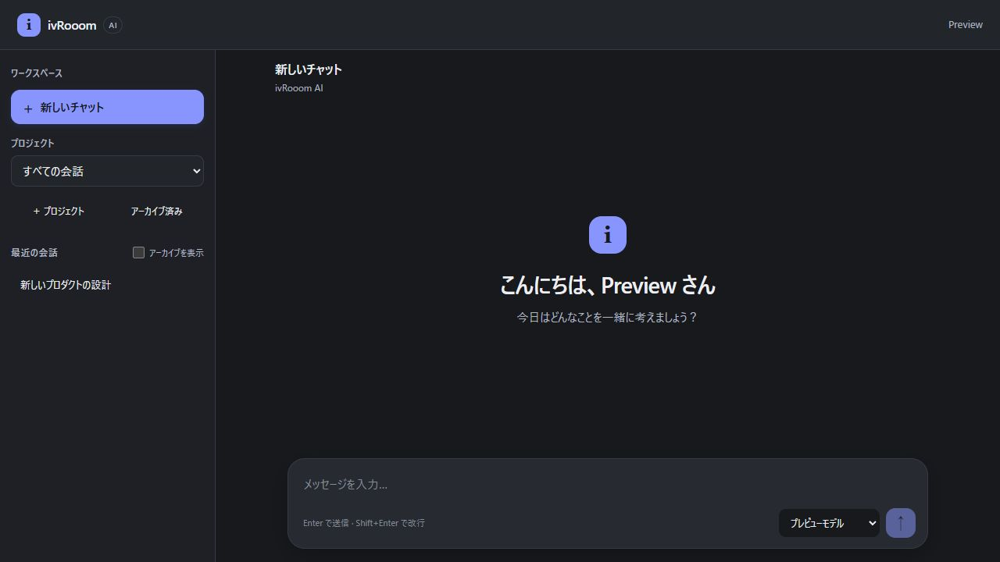
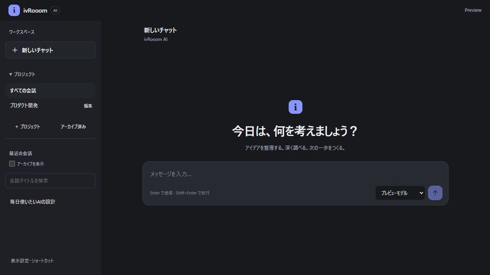
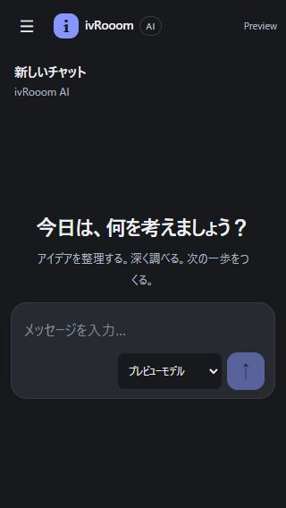

# Premium Chat Workspace — 第1弾

Issue: [#61](https://github.com/ivRooom/ivrm-ai/issues/61)。調査日: 2026-11-11 JST。

## 調査結果と判断

最新mainは `6cc05397216830c15b42df253f7d051b5b82f90f`。Deploy run
`42858199443` とmain CI `42857776801` はsuccess。配信CSSのSHA-256はmainのGit blobと一致
(`4f81d41170ff84d5aadf02f1df9393f51b3f52541a606b58a5041e8cc6d1f73e`)。
これは配信UIの照合であり、Backendコンテナdigest/DBの独立readbackではない。
本番ブラウザーでは認証済み新規画面、履歴の存在、利用可能なモデル2件を確認。
実際の会話本文は公開証跡へ保存せず、Bedrock呼び出し・本番データ変更は実施していない。

「安っぽさ」は単なる配色の問題ではない。強い主ボタン、select/checkbox/二列ボタンが
密集したSidebar、挨拶から離れたComposer、本文だけで操作できないメッセージが原因。
本番の閲覧と `web/src/main.ts` / `web/styles.css` を照合した。

## 現行Architecture

- Frontend: vanilla TypeScript、DOM helper、CSS semantic variables。独立state object、変更時再描画。
- Backend: Node/Hono、Zod、owner条件付きPostgreSQL store。memory storeはテスト用途。
- 認証: server-to-server session検証とPolicy判定。browserは同一origin APIのみ。
- AI: Bedrock Converse adapter、カタログallowlist、モデル認可、CostGate経由SSE。
- Markdown: marked + DOMPurify allowlist、安全URL制限。画像は除外、数式未対応。
- CI: Vitest、typecheck、format、build、Postgres17、Docker smoke。外部Semgrep/Snyk。
- Deploy: main限定・手動workflow_dispatch、ECR/SSM。通常push/mergeでは本番deployしない。

React移行は採用しない。今回の操作は既存の小さなDOM構成で実装できる。認証・モデル・
SSE契約とCostGateを維持し、タイトル更新だけ加算的PATCHを追加。DB migrationなし。

## 機能棚卸し（実装コードに基づく）

| 分類 | main調査時 | 第1弾の変更 / 制限 |
| --- | --- | --- |
| 会話作成・送信・履歴 | Implemented | 既存維持。履歴表示は直近200件 |
| 会話削除 | Missing | 未追加。アーカイブ/復元を維持 |
| コピー | Missing | Implemented: user/assistant原文コピー、成功/失敗表示 |
| 編集・再生成 | Missing | #31。履歴基準IDと競合・保存方式を設計して別PR |
| Streaming表示/停止 | Implemented | 過去を読んでいるときの強制スクロールを抑制 |
| 再接続/途中失敗回復 | Partial | done未着EOF検知、重複防止、再試行は次段階 |
| モデル選択/送信時切替 | Implemented | 既存維持。parameters未実装 |
| タイトル | Partial | Implemented: owner限定PATCH、名前変更dialog |
| 全文検索 | Missing | タイトル限定フィルターを追加。全文検索と表示しない |
| プロジェクト | Partial | 名前/共通指示のCRUD・archive/復元維持、直接選択navへ |
| 会話所属変更/固有モデル/ファイル | Missing | 本PRに含めない |
| Export | Missing | 表示中最大200件のMarkdown/JSON。全履歴exportではない |
| Settings | Missing | Light/Dark/System表示設定・保存・shortcut案内 |
| Files/Tools/Memory/RAG | Missing | #31/#27/#28。未接続のダミーボタンは追加しない |
| Markdown | Partial | 表/コード既存、画像/数式/シンタックス強調なし |
| Security | Implemented / 部分検証 | owner制約、CostGate、CSP、sanitizer維持。archive送信をserverでも拒否 |
| Responsive | Implemented / 部分検証 | 新規画面7サイズ×2テーマ検証。全画面・実機検収は未完了 |

## 視覚監査（5段階、主担当の暫定評価）

評価対象は新規画面とfixture会話。全画面の製品品質スコアではない。
Before/Afterは `docs/evidence/premium-workspace/` の合成データ画面。

| 評価軸 | Before | After | 根拠 |
| --- | --- | --- | --- |
| Visual Hierarchy | 2 | 3 | `.new-workspace` で挨拶とComposerを同じ入力開始領域へ |
| Typography | 3 | 3 | welcome 500 weight、本文16px/1.85、モバイル15px |
| Spacing | 2 | 3 | 直下Composer、統一content-width、Sidebar区切り |
| Alignment | 3 | 4 | Header/本文/Composer共通幅 |
| Color System | 3 | 3 | 暖色neutral + restrained accent、明示themeとnative色連動 |
| Surface Design | 2 | 3 | 新規ボタンshadow廃止、user bubble neutral、境界抑制 |
| Component Consistency | 2 | 3 | menu/dialog/item/actionの状態共通化。操作iconは統一SVGへ |
| Interaction Feedback | 2 | 3 | copy成功/失敗、rename保存中/入力error、Escape閉じる |
| Information Architecture | 2 | 3 | project直接選択、検索、設定footer、会話操作を集約 |
| Navigation | 2 | 3 | project折畳み、タイトル検索、Ctrl/⌘ K |
| Responsive Quality | 3 | 3 | 7サイズの新規画面でoverflowなし。実機keyboard未検証 |
| Accessibility | 3 | 3 | native dialog/details、label/focus、inert維持。AA認証なし |
| Product Identity | 2 | 3 | 落ち着いた専用surface。ブランドmarkの改善余地あり |

Claude/ChatGPTの「会話と入力に集中できる情報階層」、Linearの「頻度に合わせた操作密度」を
方向性として参照。各製品の資産・ロゴ・固有レイアウトは複製しない。完全なPremium品質の
検収完了とは判定しない。

## Design System

既存semantic colors（page/sidebar/surface/text/muted/line/accent/focus）を再利用。
Light: warm neutral、Dark:既存neutral dark。radius 7/12/18、content 800px、sidebar 264px、
topbar 54px。spacing scaleは既存4px刻みを維持。既存focus/reduced-motionを保持。

- Button/Input/Select: 既存default/hover/focus/disabledを共有。
- Conversation menu: native details、Escape、狭幅panel、送信中mutation/export無効。
- Rename dialog: required/300文字、空白拒否、保存中disabled、失敗時dialog内表示、Esc cancel。
- Message: 原文コピーを両roleに追加。Clipboard拒否時に成功と表示しない。
- Composer: 自動resize/IME/Enter互換を維持。新規時中央、会話中下部。
- Settings: Light/Dark/System、storage拒否でも現在表示は変更可能。

Tooltip/Toast/Tabs/Skeleton等の未使用primitivesを一括追加しない。必要な画面の実装時に状態定義を広げる。

## 優先度とリリース分割

| 次の候補 | 利用価値/頻度/UX | 工数 | API/DB | Security/費用/リスク |
| --- | --- | --- | --- | --- |
| 本PR: 基盤+copy/rename/export | 高/高/高 | 小〜中 | rename API追加/DB不要 | owner検査、追加AI費用なし、低〜中 |
| 全文検索 | 高/高/高 | 中 | owner-filtered API/初期はschema不要 | query/件数制限・検索負荷、PII漏えい防止 |
| 編集/再生成 #31 | 高/高/高 | 中〜大 | 専用history API/保存方式次第 | 二重送信・競合・CostGate、既存予算内か要確認 |
| Project workspace | 高/中/高 | 中 | 所属変更API/固有設定はschema次第 | 双方owner/archived検証、低〜中 |
| 添付 #31 | 高/中/高 | 大 | upload/参照API・保存schema | MIME/容量/ACL/retention/AI・storage費用承認 |
| Tools/RAG/Memory #27/#28 | 中〜高/未確定/高 | 大 | contracts/DB/ACL依存 | prompt injection、外部送信確認、費用・運用審査 |

Release 1は本PR、Release 2は全文検索・編集/再生成、Release 3はproject、Release 4は添付等、
Release 5は残るE2E/a11y/performance。重大な不具合は順序より先行。

## 検証と未確認事項

- ローカル: typecheck/build成功、Vitest 170 passed・29 skipped（Postgres DB未接続）。
- pnpm audit / audit --prod: 既知脆弱性なし。外部scanner成功の代替とはしない。
- 新規画面: 1440×900、1280×800、768×1024、430×932、390×844、360×800、320×568。
  Light/Darkともdocument横overflowなし、Composerがviewport内。JSONに測定結果保存。
- fixture browser: rename保存後一覧/heading更新、検索zero state、copy成功表示、JSON download
  （保存ファイルscope確認）、Light切替、mobile drawer、新規画面遷移を確認。
- 独立read-only agentレビュー: owner/SQL/XSS重大指摘なし。theme native色・scroll判定を修正。
- fixtureはUI検証用。認証/DB/AI本番E2Eの証拠ではない。previewはloopback限定、実providerを呼ばない。
- 未検証: 全画面×全size/theme、長大履歴、live SSE/Error画面、screen reader、forced colors、
  実機keyboard、総合WCAG、性能数値、認証済み本番会話送信、runtime digest。

## リリース条件とRollback

正式CIのPostgres/Docker、最新security checks、未解決レビュー、人間レビューを確認。
以前のPR #58のSnyk例外・review省略は引き継がない。現在PRは未merge/未deploy。
本番承認後のみ正式Deploy workflow（main、DEPLOY、run_migrations=false）。
Rollbackは本PRをrevertして同Workflowで配備。DB変更なし。既存データの消去不要。

## Before / After

同じ合成データ・1280×720・Dark。個人情報を含む本番画面ではない。

CI初回HEAD `818f5b2` はPostgres17を含む199/199 pass、Docker成功、Semgrep成功。
Snykはprivate tests quota errorで検査不能。人間approval未取得。本番反映は保留。
